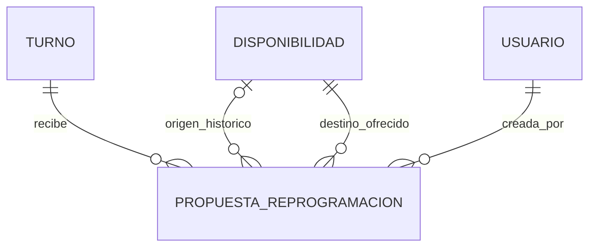

# Backend - Bloques 1, 2 y 3

Proyecto Django 5.2 LTS y DRF con PostgreSQL como unico motor. Una app
`dominio` contiene el modelo relacional; `config` contiene infraestructura.
El Bloque 1 define el esquema. El Bloque 2 agrega autenticación por sesión,
identidad y administración de cuentas internas; no conecta el frontend.
El Bloque 3 agrega catálogo, directorio de médicos y disponibilidad por agenda,
sin reservar turnos ni implementar triaje o reprogramación.

## Auditoria inicial

- A, reutilizable: frontend como referencia funcional y `.gitignore` Python.
- B, historico: `app/main.py`, `app/models/*.py`, `app/services/triaje.py`.
  Son clases/listas y un programa de consola; no son modelos ORM ni API.
- C, reemplazable: identidad y persistencia mock del frontend. Este bloque
  no las conecta ni modifica.
- D, conflicto potencial: importar los antiguos `models`/`services`, copiar
  sus IDs/credenciales o su calculo de puntaje/color/duracion. El proyecto
  nuevo no importa esos paquetes.
- No existian `app/backend`, Django, requirements, migraciones ni
  configuracion MySQL, PostgreSQL o Supabase. `.env` ya estaba ignorado;
  ahora tambien se ignoran sus variantes privadas, conservando `.env.example`.

## Preparacion

Desde la raiz del repositorio, con Python 3.10 o superior compatible:

```powershell
python -m venv .venv
.\.venv\Scripts\python.exe -m pip install -r app/backend/requirements.txt
Copy-Item app/backend/.env.example app/backend/.env
.\.venv\Scripts\python.exe -c "import secrets; print(secrets.token_urlsafe(64))"
```

Completar el archivo privado con una clave generada y datos reales de una
base PostgreSQL de desarrollo. El comando de clave solo imprime un valor;
no crea credenciales demo. Variables del proceso prevalecen sobre `.env`.
Sin `DJANGO_SECRET_KEY` el proyecto falla explicitamente al iniciar.
Sin `POSTGRES_DB` los comandos que necesitan conexion fallan; no hay fallback.

| Variable | Uso |
| --- | --- |
| DJANGO_SECRET_KEY | Obligatoria; clave privada de Django |
| DJANGO_DEBUG | `false` por defecto; `true` solo en desarrollo |
| DJANGO_ALLOWED_HOSTS | Hosts separados por comas |
| POSTGRES_DB | Nombre real de la base, requerido para conectar |
| POSTGRES_USER / POSTGRES_PASSWORD | Credenciales segun el servidor |
| POSTGRES_HOST / POSTGRES_PORT | localhost / 5432 por defecto |
| POSTGRES_SSLMODE | prefer local; require o verify-full segun proveedor remoto |

Para Supabase utilizar los parametros reales proporcionados por el proyecto,
incluidos host de conexion/pooler y politica SSL; no se incluye ninguna cuenta.
Se requiere PostgreSQL 14 o superior para Django 5.2.

```powershell
cd app/backend
..\..\.venv\Scripts\python.exe manage.py check
..\..\.venv\Scripts\python.exe manage.py makemigrations --check
..\..\.venv\Scripts\python.exe manage.py migrate
..\..\.venv\Scripts\python.exe manage.py test dominio
```

Las pruebas de BD usan una base de test separada administrada por Django:
usar exclusivamente un servidor de desarrollo con permisos para crearla.
No ejecutar tests contra una cuenta de produccion. No cargan fixtures ni dejan
cuentas demo en la base normal.

Pruebas que no necesitan PostgreSQL:

```powershell
..\..\.venv\Scripts\python.exe manage.py test dominio.tests.EstructuraTests
```

WSGI y ASGI estan configurados. `manage.py runserver` puede iniciarse una vez
configurada la conexion; aun no hay rutas funcionales y `/` responde 404.

## Modelo y decisiones

Todos los modelos tienen PK estable BigAutoField; Turno y Triaje la nombran
`id_turno` e `id_triaje`. No se conservan los IDs independientes del prototipo
como nuevas identidades.

| Modelo | Campos y relaciones |
| --- | --- |
| Usuario | id, email unico, password/last_login heredados, nombre, apellido, dni, telefono, rol, is_active, is_staff, is_superuser, date_joined y permisos/grupos Django |
| Paciente | id, usuario 1:1 obligatorio, obra_social opcional |
| Medico | id, usuario 1:1 obligatorio, matricula unica, especialidad FK obligatoria |
| Secretaria | id, usuario 1:1 obligatorio, legajo unico |
| Especialidad | id, nombre unico; admite Clinica Medica, Cardiologia y Pediatria sin seed automatico |
| Disponibilidad | id, medico FK, fecha, hora_inicio, hora_fin, estado |
| Turno | id_turno, fecha, hora, estado, duracion_turno (minutos), fecha_hora_creacion, fecha_hora_arribo/inicio/cierre, paciente, medico, disponibilidad, secretaria |
| Triaje | id_triaje, turno 1:1 obligatorio, respuesta_sintomas, nivel_prioridad, fecha_hora_evaluacion |

- Usuario hereda AbstractBaseUser y PermissionsMixin. USERNAME_FIELD=email;
  AUTH_USER_MODEL se define antes de la migracion inicial. El manager usa
  set_password y normaliza email. UniqueConstraint(Lower(email)) asegura
  unicidad sin distinguir mayusculas incluso con escrituras fuera del manager.
  Las escrituras futuras deben usar el manager/set_password: el ORM no impide
  asignaciones directas al campo password. No hay tabla de credenciales paralela.
- Administrador es un rol; no posee perfil separado. is_staff/is_superuser son
  flags tecnicos de Django, no sustituyen el rol de dominio.
- Los perfiles solo guardan datos especificos. clean() valida su correspondencia
  de rol y limit_choices_to ayuda en formularios. No es un CHECK entre tablas:
  save()/bulk_create no ejecutan full_clean automaticamente. Bloque 2 debe
  validar y crear usuario/perfil atomicamente y controlar cambios de rol.
- Medico tiene una especialidad; las reglas clinicas quedan fuera del modelo.
- Disponibilidad diferencia DISPONIBLE, OCUPADO y BLOQUEADO. No se calcula
  ocupacion automaticamente ni se resuelven solapamientos en este bloque.
- Turno permite disponibilidad y secretaria NULL, ademas de los tres timestamps
  operativos NULL hasta que ocurren. Las demas relaciones son obligatorias.
  Disponibilidad es FK, no 1:1: un bloque puede conservar referencias de turnos
  cancelados y utilizarse posteriormente por otra reserva.
- fecha_hora_creacion usa default=timezone.now, no auto_now; actualizar estado
  no cambia la fecha. editable=False evita edicion en formularios, pero no
  vuelve inmutable el dato frente a escrituras ORM explicitas. El default
  permite importar una fecha historica real en una migracion futura.
- duracion_turno es positiva e independiente del triaje. La coincidencia de
  medico/fecha/hora/duracion con disponibilidad sera validada por el servicio
  transaccional de un bloque posterior, junto con concurrencia y revalidacion del bloque.
- Triaje usa JSONField (jsonb en PostgreSQL) para respuestas estructuradas de
  distintos cuestionarios. clean() exige objeto; no define reglas clinicas ni
  un esquema de sintomas que aun corresponda implementar en otro bloque.
- Turno puede no tener Triaje: Cardiologia no recibe prioridad BAJA artificial.
  El esquema no impone restricciones clinicas por especialidad; eso se validara
  posteriormente. No se agrega prioridad al Turno ni duracion al Triaje.
- AUSENTE permanece como compatibilidad historica, sin flujo nuevo.
- Las relaciones usan PROTECT para impedir borrados accidentales de historial.
  Activar/desactivar cuentas y cancelar turnos son cambios de estado.
- Un indice de agenda (medico, fecha, estado, fecha_hora_creacion) soporta
  consultas posteriores sin establecer ranking global ni ejecutar el desempate.

## Constraints y limites

BD: unicidad de email exacta y case insensitive, roles validos, perfiles 1:1,
nombre de especialidad/matricula/legajo unicos, FK protegidas, intervalo de
disponibilidad positivo, bloque exacto unico por medico/fecha/inicio/fin,
estados de disponibilidad y turno validos, duracion positiva, Turno-Triaje 1:1
y prioridad ALTA/MEDIA/BAJA valida.

No se agregan triggers ni exclusiones de intervalos ni validaciones entre
tablas dentro de CHECK. Estados de disponibilidad y reservas deben sincronizarse
mediante servicios transaccionales futuros. Las validaciones de clean requieren
full_clean o invocacion explicita por serializers/services.

## Alcance originalmente previsto para Bloque 2 (referencia del Bloque 1)

Autenticacion API, validacion de password en endpoints, permisos por rol,
administracion de cuentas sobre Usuario unico, manejo de sesion/token,
intentos fallidos/bloqueo/caducidad y recuperacion. Definir contratos y
servicios de operaciones que se habiliten: no implementar de golpe todos los
flujos ni migrar JSON sin una estrategia de seed acordada.

La politica completa de complejidad del prototipo debe acordarse y aplicarse
con validadores de password cuando se expongan altas/cambios. La base configura
los validadores estandar de Django; create_user no ejecuta validate_password.
Al cierre del Bloque 1 no habia integracion frontend, endpoints Admin, metricas definitivas, reglas
clinicas, modelos Reprogramacion/ListaEspera/Notificacion ni seeds.

## Verificacion historica del Bloque 1 - 2026-11-02

Punto de partida: rama `feature/triage-final`, HEAD `a090fbc`, arbol limpio.
Se utilizaron Django 5.2.18, DRF 3.16.1, psycopg 3.3.6 y python-dotenv 1.2.4,
instalados en `.venv` ignorado. No se creo `.env` ni se guardo una clave:
los checks recibieron una clave efimera generada en el entorno del proceso.

| Comprobacion | Resultado |
| --- | --- |
| manage.py check | Exit 0; System check identified no issues (0 silenced). |
| manage.py test dominio.tests.EstructuraTests | Exit 0; 8 tests, OK; sin preparar BD |
| Sintaxis AST e imports Python nuevos | Exit 0; 13 archivos; WSGI, ASGI y migracion incluidos |
| pip check | Exit 0; No broken requirements found. |
| Grafo inicial y comparacion offline modelos/migraciones | Exit 0; sin cambios detectados |
| manage.py makemigrations --check | Exit 1; ImproperlyConfigured: falta NAME u OPTIONS['service'] en DATABASES |
| manage.py migrate | No ejecutado: sin PostgreSQL configurado |
| 10 tests IntegridadPostgreSQLTests | Pendientes: requieren BD de desarrollo |
| git diff --check y revision --no-index de archivos nuevos | Exit 0; sin errores de whitespace |
| git diff --exit-code -- app/frontend y status de frontend | Exit 0; sin cambios |
| git check-ignore | .env, .env.production y .venv ignorados; .env.example visible |

La migracion `dominio/migrations/0001_initial.py` fue generada con las APIs
MigrationLoader(None), MigrationAutodetector y MigrationWriter de Django,
sin conexion ni SQLite. Se uso el mismo contexto sin traducciones que utiliza
makemigrations para evitar diferencias artificiales en los modelos de auth.
Depende de `auth.0012_alter_user_first_name_max_length`. Una segunda carga del
grafo y comparacion contra ProjectState.from_apps no detecto diferencias.
Esto valida archivos/estado de modelos, NO la aplicacion de SQL en PostgreSQL.

La revision de configuracion no encontro secretos reales agregados. Las
menciones a score/color en tests comprueban su ausencia; no son campos clinicos.
Se conservaron los archivos historicos. Estado final esperado:

```text
 M .gitignore
?? app/backend/
```

Unico archivo existente modificado: `.gitignore`. Archivos nuevos:
`.env.example`, `requirements.txt`, `README.md`, `manage.py`,
`config/{__init__,settings,urls,wsgi,asgi}.py`,
`dominio/{__init__,apps,managers,models,tests}.py`,
`dominio/migrations/{__init__,0001_initial}.py`.

Antes de cerrar la verificacion de BD: configurar una conexion PostgreSQL real,
repetir makemigrations --check, aplicar migrate y ejecutar los 18 tests.
No hubo commit ni push y el frontend permanece congelado.

## Bloque 2 implementado: identidad y autorización

### Decisiones y límites

- Sesiones de Django + SessionAuthentication de DRF. Sin JWT, tokens propios,
  paquetes nuevos ni tablas nuevas. La ampliación agrega el contador en 0002. Se reutiliza
  django_session, cuya migración debe estar aplicada.
- Email normalizado y búsqueda sin distinguir mayúsculas. La restricción
  usuario_email_ci_unique sigue siendo la garantía final en PostgreSQL.
- Todas las contraseñas se escriben con create_user/set_password. Altas y cambio
  propio ejecutan los validadores estándar de Django ya configurados.
- Una cuenta activa debe tener exactamente el perfil de su rol. Administrador
  no tiene perfil. Login rechaza perfiles faltantes/cruzados/múltiples; las
  operaciones autenticadas vuelven a comprobar esta condición.
- Rol de dominio y permisos técnicos son distintos: ADMINISTRADOR no necesita
  is_staff/is_superuser para administrar estas cuentas. Esos flags tampoco
  otorgan acceso a un rol diferente.
- Usuario/perfil se guardan en una transacción. El administrador solo gestiona
  MEDICO/SECRETARIA, no crea pacientes ni otros administradores. Al editar no
  puede cambiar rol/DNI, asignar privilegios ni cambiar contraseñas ajenas.
  Activar/desactivar usa PATCH is_active; no existe DELETE de cuentas.
- No se implementan consultas ni operaciones de turnos, agenda, triaje,
  disponibilidad, reprogramación, registro público
  o edición del perfil propio en este bloque.

### Endpoints

Todas las rutas tienen prefijo `/api/` y barra final. Respuestas JSON.

| Método/ruta | Acceso y contrato |
| --- | --- |
| GET auth/csrf/ | Público. Entrega csrfToken y cookie CSRF para iniciar el flujo. |
| POST auth/login/ | Público con CSRF. Body: email, password. Devuelve usuario y csrfToken renovado; establece sesión. |
| POST auth/logout/ | Sesión + CSRF. Invalida la sesión actual; 204. |
| GET auth/me/ | Cuenta activa/perfil válido. Solo identidad propia y perfil necesario. |
| POST auth/password/ | Cuenta activa + CSRF. password_actual, password_nueva, password_confirmacion. |
| POST auth/password-reset/ | Público + CSRF. email; respuesta genérica, envío solo a cuentas elegibles. |
| POST auth/password-reset/confirm/ | Público + CSRF. uid, token, password_nueva, password_confirmacion. |
| GET/POST admin/usuarios/ | Solo ADMINISTRADOR. Lista paginada / alta interna. |
| GET/PUT/PATCH admin/usuarios/{id}/ | Solo ADMINISTRADOR, únicamente Médico/Secretaría. |
| GET admin/especialidades/ | Solo ADMINISTRADOR. Catálogo existente para seleccionar especialidad al crear/editar médicos; no permite escribir. |

Ejemplo de alta de médico (usar una contraseña privada que cumpla validadores):

```json
{
  "email": "profesional@example.com",
  "password": "<contraseña privada>",
  "nombre": "Nombre",
  "apellido": "Apellido",
  "dni": "12345678",
  "telefono": "3515551234",
  "rol": "MEDICO",
  "matricula": "MP-12345",
  "especialidad": 1
}
```

El ID de especialidad debe existir en PostgreSQL; no se crea un seed implícito.
Para SECRETARIA enviar legajo en lugar de matricula/especialidad. is_active es
opcional al crear (true por defecto). PATCH admite campos parciales; PUT exige
los campos generales requeridos. El rol es inmutable en ambos casos.

La respuesta de identidad contiene exclusivamente id, email, nombre, apellido,
dni, telefono, rol, is_active y perfil. perfil es null para ADMINISTRADOR; para
Paciente contiene id/obra_social, para Médico id/matricula/especialidad
(id/nombre), para Secretaría id/legajo. Nunca devuelve password, hash, grupos
o flags técnicos. No usar las credenciales ni los IDs del frontend como seed.

### Sesión y CSRF

1. GET auth/csrf/ conservando cookies.
2. POST auth/login/ con email/password y encabezado X-CSRFToken.
3. Conservar la cookie sessionid HttpOnly. Login rota el token CSRF: usar el
   nuevo csrfToken de la respuesta (o la cookie csrftoken actualizada).
4. Enviar X-CSRFToken y cookies en cada POST/PUT/PATCH/DELETE posterior.

Login tiene csrf_protect explícito: SessionAuthentication por sí sola no
protege el login anónimo. Credenciales incorrectas, inactividad o perfil
inconsistente devuelven el mismo 401. En endpoints protegidos, una petición
anónima devuelve 403 con SessionAuthentication; un rol insuficiente también
devuelve 403. Datos inválidos devuelven 400; usuarios fuera del alcance
administrativo devuelven 404; métodos no habilitados devuelven 405.

CuentaBackend deriva de ModelBackend y rechaza is_active=False al autenticar y al recuperar una sesión
en peticiones posteriores. Los permisos de API también comprueban actividad.
El cambio de contraseña verifica la actual y la confirmación, aplica la
política y usa update_session_auth_hash: conserva/rota la sesión actual y las
otras sesiones dejan de ser válidas en su próxima petición.

Login tiene un throttle complementario de 10 solicitudes/minuto por IP con el
cache estándar de Django. Es independiente del contador persistente de cinco
contraseñas incorrectas por cuenta descrito abajo; no es protección distribuida definitiva.
NUM_PROXIES=0 evita confiar en X-Forwarded-For enviado directamente por un
cliente; revisar esa configuración junto con el proxy real al desplegar.

Cookies Secure por defecto con DEBUG=false; en HTTP local usar DEBUG=true.
Para producción se requiere HTTPS. SameSite=Lax y sesión HttpOnly. La
integración futura se plantea bajo el mismo origen; no se habilitó CORS ni
se debilitó CSRF para el servidor estático del frontend. Orígenes confiables
adicionales se configuran explícitamente en DJANGO_CSRF_TRUSTED_ORIGINS.

### Administración inicial y pruebas

Crear el administrador inicial mediante `manage.py createsuperuser` (email,
contraseña y datos requeridos). No hay credenciales por defecto ni tabla
Administrador. Los usuarios no administradores creados directamente por
scripts requieren su perfil correspondiente antes de poder iniciar sesión.
Las escrituras ORM externas siguen siendo responsables de validar el rol y
perfil: no se agregaron triggers ni constraints entre tablas.

```powershell
& ./.venv/Scripts/python.exe manage.py check
& ./.venv/Scripts/python.exe manage.py makemigrations --check --dry-run
$env:POSTGRES_TEST_DB = 'test_tesis_identity_' + [guid]::NewGuid().ToString('N').Substring(0,12)
& ./.venv/Scripts/python.exe manage.py test dominio --noinput
```

Ejecutar desde app/backend. Django crea y destruye una BD PostgreSQL aislada;
la cuenta de pruebas debe tener permiso CREATEDB. Nunca configurar
POSTGRES_TEST_DB con el nombre de desarrollo/producción. Los tests usan
APIClient con CSRF habilitado, sesiones reales y hashing PBKDF2 de Django.
No hacen peticiones de escritura a la base de desarrollo ni al frontend.

Pendientes de despliegue: HTTPS/proxy, cache compartido, entrega de email,
verificación de email inicial y auditoría según requisitos posteriores.
Los permisos por rol no sustituyen futuras restricciones por objeto/agenda:
esas reglas se implementarán al exponer operaciones de los siguientes bloques.

### Verificación inicial del Bloque 2 — 2026-11-02 (antes de recuperación)

- `manage.py check`: sin incidencias.
- `manage.py makemigrations --check --dry-run`: No changes detected.
- `manage.py test dominio --noinput`: 45 tests aprobados (18 del Bloque 1 y
  27 de API/identidad), sobre una BD PostgreSQL temporal con nombre único.
  Django creó y eliminó esa base; no se migró ni escribió en la de desarrollo.
- `pip check`, parseo AST e imports ejecutados por la suite: correctos.
- Sin cambios en frontend, models.py, migración 0001 ni requirements.txt.
- Sin migraciones nuevas, commit o push.

## Ampliación B2: cinco fallos y recuperación

`Usuario.intentos_fallidos` es persistente, comienza en cero y tiene constraint
PostgreSQL 0–5. `bloqueado_por_intentos` se calcula al llegar a cinco: no es una
columna ni modifica is_active. No hay fecha ni desbloqueo automático por tiempo.

AUTHENTICATION_BACKENDS contiene únicamente CuentaBackend. No dejar ModelBackend
como fallback: permitiría saltarse el bloqueo. Como cambia el nombre de backend
guardado en sesiones anteriores a esta ampliación, se requiere volver a iniciar
sesión una vez desplegada. El administrador inicial también está sujeto a la
política; necesita un email real/configurado para recuperación en producción.

Cada contraseña incorrecta evaluada de una cuenta existente/no bloqueada suma
uno. El quinto fallo bloquea; una contraseña correcta posterior no autentica ni
reinicia nada. Un login exitoso antes del quinto reinicia a cero. Contraseña
correcta de cuenta inactiva/perfil inválido no es login exitoso. Se preservan
respuestas 401 genéricas; no se publican contador ni estado de bloqueo.
Entrada incompleta, fallo CSRF o throttle 429 no cuentan como contraseña errónea.

authenticate usa transaction.atomic/select_for_update sobre la fila Usuario;
LoginView mantiene la transacción hasta login/last_login. Los fallos se guardan
retornando normalmente, sin una excepción que deshaga su incremento. La garantía
por cuenta funciona entre procesos/IPs usando PostgreSQL. No depende del cache.
La administración guarda únicamente campos editados; una copia anterior ya no
puede sobrescribir contador, password o last_login. La API no permite editar el
contador ni desbloquear cuentas manualmente.

El bloqueo afecta nuevas autenticaciones por contraseña. Las sesiones abiertas
con CuentaBackend pueden seguir operando hasta cierre, vencimiento o reset. Sin
embargo, el endpoint de cambio de contraseña propia rechaza cuentas bloqueadas:
el desbloqueo exige recuperación por email. Antes del bloqueo, ese cambio sigue
conservando su sesión y no reinicia el contador de fallos.

### Recuperación por API

1. Obtener CSRF y enviar POST `/api/auth/password-reset/` con email.
2. Siempre se responde 200 con el mismo mensaje para emails sintácticamente
   válidos: existentes, inexistentes, inactivos o bloqueados. No se expone token.
3. PasswordResetForm envía solo a cuentas activas con contraseña utilizable.
   No cambia intentos, contraseña ni activación. Un perfil inconsistente sigue
   requiriendo corrección administrativa: reset no lo repara.
4. El correo contiene uid/token y URL del endpoint de confirmación. El origen
   sale de PASSWORD_RESET_BASE_URL, no del Host de la petición.
5. POST `/api/auth/password-reset/confirm/` con uid, token, password_nueva y
   password_confirmacion. Mantener CSRF también para este endpoint público.

Este bloque entrega la API, no una pantalla nueva del frontend. El enlace del
email identifica el endpoint y sus parámetros: para completar el flujo se usa
POST desde el cliente/APIClient/Postman. Abrirlo como GET no cambia contraseña.
La pantalla de recuperación y su conexión con esta API quedan para integración
del frontend; no se añadió una interfaz de recuperación en este bloque.

Se usa default_token_generator de Django, sin almacenar ni implementar tokens
propios, y SetPasswordForm para política/confirmación/hashing. La confirmación
vuelve a cargar/bloquear la fila y verifica el token dentro de la transacción;
guarda password e intentos_fallidos=0 conjuntamente. Dos confirmaciones del mismo
token no pueden consumirlo simultáneamente. No se inicia sesión automáticamente
ni se conserva una sesión previa mediante update_session_auth_hash: todas las
sesiones anteriores dejan de autenticar al siguiente acceso por cambio del hash.

PASSWORD_RESET_TIMEOUT es 3600 segundos. Un token vencido no desbloquea y puede
reemplazarse solicitando otro correo; reenviar tampoco reinicia intentos. Puede
haber varios enlaces aún válidos; el primer reset exitoso invalida los demás al
cambiar la contraseña. Token inválido/vencido/usuario inactivo se rechaza con un
mismo error 400. Un reset nunca reactiva is_active=False.

Solicitud y confirmación comparten un throttle complementario de 10 peticiones
por minuto/IP, separado del scope de login. SMTP fallido se registra mediante
el comportamiento nativo de Django y conserva respuesta genérica. La entrega
SMTP síncrona puede producir diferencias de tiempo: las respuestas uniformes
no eliminan totalmente ese canal de enumeración. Para producción debe evaluarse
envío asíncrono y cache compartido; no se agregaron colas ni librerías externas.

### Email y despliegue

- DEBUG=true: backend de consola por defecto; no prueba entrega ni control real
  del buzón. Solo se utiliza para desarrollo.
- Tests: locmem, inspección del correo y tokens sin envío real.
- DEBUG=false: SMTP por defecto. Configurar EMAIL_BACKEND, EMAIL_HOST/PORT,
  EMAIL_HOST_USER/PASSWORD, EMAIL_USE_TLS o EMAIL_USE_SSL, DEFAULT_FROM_EMAIL y
  PASSWORD_RESET_BASE_URL (origen público HTTPS). No habilitar TLS y SSL a la vez.
- EMAIL_TIMEOUT=10 segundos limita esperas de transporte; no es un timeout de
  bloqueo. No dejar el backend de consola en producción. Las credenciales se
  configuran en entorno/.env privado, nunca en Git.
- Aplicar únicamente `manage.py migrate` para incorporar 0002. Agrega el contador
  inicial cero a usuarios existentes y su constraint; no modifica 0001 ni perfiles.

La suite incluye los 45 tests previos y pruebas adicionales de bloqueo, reset,
caducidad/reenvío, CSRF, correo, campos protegidos y carreras reales PostgreSQL
con TransactionTestCase y conexiones independientes. No utilizar SQLite para
afirmar la garantía de select_for_update.

### Verificación de la ampliación — 2026-11-02

- 70 tests PostgreSQL aprobados: 45 previos y 25 nuevos, incluidos cuatro de
  concurrencia real. Duración de ejecución: aproximadamente 386 segundos.
- El teardown inicial devolvió error porque Supavisor retenía seis conexiones
  ociosas. Se completó luego la eliminación de la base temporal mediante el
  helper de Django apuntado explícitamente a ella, sin terminar sesiones ni
  ejecutar SQL manual. El fallo fue posterior al OK de los 70 tests.
- En conexiones mediante pooler, la limpieza puede requerir reintento cuando
  libere sus conexiones; alternativamente usar --keepdb sobre una base de test
  dedicada o una conexión PostgreSQL directa para pruebas. Nunca usar la base
  de desarrollo como base de test.
- 0002 fue aplicada a la base configurada exclusivamente mediante
  `manage.py migrate dominio 0002 --noinput`, después de revisar --plan.
- manage.py check, makemigrations --check, migrate --check y pip check correctos.
- Frontend, 0001_initial y requirements.txt intactos. Sin commit ni push.

## Bloque 3: especialidades, médicos y disponibilidad

### Modelo y catálogo

Especialidad -> Medico -> Disponibilidad. El identificador de agenda es
Medico.pk, distinto de Usuario.pk. Disponibilidad no duplica especialidad ni
almacena duración/prioridad: duracion_minutos se calcula del intervalo. Los
bloques nuevos tienen precisión de minutos y pertenecen a una fecha, sin
intervalos que crucen medianoche. No hay mínimo clínico de veinte minutos.

0003_catalogo_especialidades es exclusivamente una data migration. Provisiona
Clínica Médica, Pediatría y Cardiología con get_or_create por nombre canónico,
sin IDs fijos. Es idempotente y no modifica especialidades preexistentes ni
interpreta aliases del frontend. Su reversa no borra datos que podrían estar
referenciados; reaplicarla tampoco duplica el catálogo. No cambia models.py,
0001, 0002 ni instala extensiones PostgreSQL.

El catálogo es de solo lectura para la API. La administración de cuentas sigue
en B2. Una especialidad solo puede cambiarse si el médico todavía no tiene
disponibilidades ni turnos, incluidos históricos/sin disponibilidad. B2 adquiere
el mismo bloqueo de Medico y revalida la condición antes de guardar. La edición
de otros datos del profesional y el envío de la misma especialidad siguen
permitidos. No se pueden trasladar bloques a otro médico.

### Contrato de endpoints (prefijo /api/)

| Método/ruta | Acceso |
| --- | --- |
| GET especialidades/ | Los cuatro roles autenticados/activos con perfil válido. |
| GET admin/especialidades/ | Conserva el contrato B2: solo Administrador. |
| GET medicos/ | Los cuatro roles; filtros especialidad={id}, incluir_inactivos=true. |
| GET medicos/{id}/ | Directorio seguro de profesionales. |
| GET medicos/{medico_pk}/disponibilidades/ | Paciente: solo futuras DISPONIBLE; Médico: propia agenda; Secretaría: agenda explícita. |
| GET medicos/{medico_pk}/disponibilidades/{id}/ | Mismos límites de consulta, también para el bloque individual. |
| POST medicos/{medico_pk}/disponibilidades/ | Médico propio o Secretaría. Crea un bloque DISPONIBLE. |
| POST medicos/{medico_pk}/disponibilidades/lote/ | Mismos roles, 1–100 bloques explícitos en una transacción. |
| PATCH medicos/{medico_pk}/disponibilidades/{id}/ | Mismos roles. Solo fecha/hora_inicio/hora_fin. |
| POST .../disponibilidades/{id}/bloquear/ | Mismos roles; sin body. DISPONIBLE -> BLOQUEADO. |
| POST .../disponibilidades/{id}/desbloquear/ | Mismos roles; sin body. BLOQUEADO -> DISPONIBLE. |
| DELETE .../disponibilidades/{id}/ | Mismos roles; bloque futuro no ocupado y sin ningún Turno relacionado. |

Escrituras con sesión y CSRF de B2. Administrador no tiene acceso operativo a
disponibilidad. Un médico accede al directorio de otros profesionales, pero no
a sus agendas. Los intentos de usar otra agenda/bloque anidado ajeno devuelven
404; roles sin permiso devuelven 403. PUT de disponibilidad no está habilitado.

Los listados son paginados (page, tamaño configurado en B2). Médicos expone solo
id, nombre, apellido, matricula y especialidad {id,nombre}. No expone DNI,
credenciales ni email. Por defecto excluye cuentas médicas inactivas; solo
Secretaría/Administrador pueden solicitar incluir_inactivos=true. Un paciente
no puede consultar disponibilidad de un médico inactivo. Secretaría conserva
acceso de lectura a esas agendas, puede retirar/bloquear bloques, pero no crear,
modificar intervalos ni desbloquear para habilitar horarios del médico inactivo.

Disponibilidad expone id, medico, fecha, hora_inicio, hora_fin, estado y
duracion_minutos. No publica paciente/turno. Filtros: fecha o desde/hasta, estado;
se validan formatos/rangos. Un paciente no puede ampliar su visibilidad con esos
filtros. Las vistas profesionales conservan consulta del historial, incluso pasado.
El orden es fecha/hora/ID: no se trata de priorización clínica ni antigüedad.

Creación individual:

```json
{"fecha":"2099-01-01","hora_inicio":"09:00","hora_fin":"09:20"}
```

Lote (los intervalos vienen de una selección/configuración explícita):

```json
{"bloques":[
  {"fecha":"2099-01-01","hora_inicio":"09:00","hora_fin":"09:20"},
  {"fecha":"2099-01-01","hora_inicio":"09:20","hora_fin":"09:40"}
]}
```

POST devuelve 201; PATCH/acciones 200; DELETE 204. No se aceptan médico,
especialidad, estado, duración ni ID enviados como campos de escritura.
Ningún endpoint permite establecer OCUPADO. Duplicado/solapamiento, ocupación o
historial incompatible devuelven 409; formatos, intervalos y fechas pasadas 400.

### Servicio transaccional y límites para B4

agenda.py concentra create_blocks/update_block/set_blocked/delete_block. Primero
autoriza al actor, bloquea Medico con select_for_update y después el bloque
concreto. Valida nuevamente dentro de atomic. La misma agenda no admite
solapamientos, duplicados ni contenciones, cualquiera sea el estado existente;
intervalos adyacentes sí se permiten. Médicos distintos son independientes.
El lote valida contra la BD y contra sí mismo antes de insertar: fallo implica
cero altas del lote. PATCH usa valores actuales, no una copia antigua, y escribe
únicamente campos editados. Bloquear/desbloquear es idempotente y no altera Turno.

OCUPADO es exclusivo de las futuras operaciones de Turno en B4. B3 nunca lo
asigna ni modifica/elimina un bloque con ese estado. No se cambia fecha/horario
ni se elimina un bloque con cualquier referencia de Turno, aunque esté cancelado.
El bloqueo de un recurso actualmente DISPONIBLE puede cambiar su configuración
sin borrar historial cancelado ni alterar el Turno. No se representa simultáneamente
OCUPADO+BLOQUEADO. Pasado se conserva para lectura, no se reescribe ni elimina
desde estas operaciones. Consultar no genera bloques ni modifica su estado.

No hay ExclusionConstraint: la exclusión parcial se garantiza para operaciones
que pasan por este servicio y usan el bloqueo del padre. SQL/scripts externos
pueden saltar esa regla; la BD sigue protegiendo intervalo y duplicado exacto.
B4 debe seguir el mismo orden de bloqueos, comprobar médico/actividad/estado,
revalidar el bloque y guardar Turno + ocupación/liberación conjuntamente. Una
lectura actual DISPONIBLE no constituye una reserva. Debe definir qué estados de
Turno consumen un bloque y cómo se tratará una indisponibilidad sobre uno ocupado.

No hay algoritmo de triaje, prioridad, sobreturnos ni duración clínica en B3.
Cardiología no recibe prioridad Baja artificial. Los IDs proceden de PostgreSQL;
no se copiaron JSON, localStorage, aliases o reconciliaciones del frontend.

### Validación B3

Los 70 tests de B1/B2 se conservan. El fixture de identidad usa get_or_create
para Clínica Médica y verifica su presencia en el catálogo (ya no supone un
catálogo de una única fila). Se agregan pruebas API, catálogo idempotente,
matriz de roles, historial, lotes y concurrencia PostgreSQL mediante conexiones
independientes. Para Supavisor se usa una base temporal única con --keepdb y
limpieza posterior mediante Django; esto evita hacer fallar el resultado de la
suite por conexiones ociosas retenidas durante el teardown automático.

## B4 — Turnos, triaje y reserva

La solicitud persistida nace exclusivamente al confirmar la reserva. No se
persisten cuestionarios preliminares ni Turnos incompletos. El backend genera
fecha_hora_creacion al crear Turno; la API B4 no ofrece modificaciones del Turno.

### API (prefijo /api/)

| Método/ruta | Acceso |
| --- | --- |
| POST medicos/{medico_pk}/turnos/ | Paciente activo con perfil válido; reserva para sí. |
| GET turnos/ | Paciente: listado propio paginado. |
| GET turnos/{id_turno}/ | Paciente: detalle propio; ajenos devuelven 404. |
| GET medicos/{medico_pk}/turnos/ | Médico propio o Secretaría con médico explícito. Filtros fecha/estado. |
| GET medicos/{medico_pk}/turnos/{id_turno}/ | Mismos límites de agenda. |

El POST acepta únicamente disponibilidad (entero positivo) y respuestas cuando
la especialidad real del médico tiene algoritmo. No acepta paciente, médico,
estado, prioridad, duración ni timestamps. Las consultas se ordenan por fecha,
hora e ID; no implementan precedencia por prioridad. Administrador no opera
turnos; Secretaría no reserva por terceros en B4. Autenticación de sesión y
CSRF conservan el contrato B2.

Reserva Clínica Médica:

```json
{"disponibilidad":123,"respuestas":{"fiebre":false,"dificultadRespirar":false,"dolor":4}}
```

Pediatría requiere fechaNacimiento (YYYY-MM-DD), fiebre, duracionFiebreHoras,
dificultadRespirar, muyAgitado, estadoGeneral y vomitosRepetidos. Los indicadores
son booleanos JSON estrictos. Con fiebre, duración finita >= 0; sin fiebre,
duración null explícita. Estado general admite alerta_normal,
decaido_responde_normalmente, letargico_muy_somnoliento,
pobre_respuesta_estimulos o dificultad_despertar. Dolor de Clínica es entero
0–10. No se completan campos faltantes ni se convierten cadenas/números en
booleanos. Se rechazan campos desconocidos. La validación completa precede a
cualquier clasificación, incluso ante un indicador de prioridad Alta.

triage.py implementa CM-01..05 y PED-01..09 con precedencia ALTA/MEDIA/BAJA,
sin ORM ni HTTP. La edad usa meses calendario, ajustando al último día del mes;
exactamente tres meses no cumple menor de tres meses. La evaluación utiliza la
fecha local del servidor. Es priorización preliminar ambulatoria autoinformada,
no diagnóstico ni sustituto de evaluación profesional.

Sin algoritmo (incluida Cardiología) se omite respuestas: no existe fila Triaje
y la API devuelve prioridad y triaje null. Enviar respuestas se rechaza.
No se copia ni modifica el frontend, mocks o almacenamiento local.

turnos.reservar_turno usa atomic y locks Medico -> Usuario relacionados por PK
-> Disponibilidad. La autorización de reserva no amplía los permisos B3.
Revalida actividad/perfiles, pertenencia del bloque, DISPONIBLE, intervalo válido
y futuro, y ausencia de asociaciones consumidoras. Historial cancelado no
consume el bloque; cualquier otra asociación incompatible exige revisión.
Deriva fecha/hora/duración entera del bloque y crea Turno RESERVADO, exactamente
un Triaje para CM/PED y disponibilidad OCUPADO en una transacción. Un fallo
revierte todas las escrituras. No hay sobreturnos ni horarios alternativos.

POST devuelve 201. Validación de entrada/cuestionario: 400; rol o CSRF: 403;
recurso inexistente/ajeno: 404; conflicto de bloque, médico inactivo o intervalo
vencido: 409. Los detalles no exponen credenciales, email ni DNI.

No hay migración 0004. La FK de disponibilidad conserva historial y no es
única: la exclusividad activa se garantiza mediante el servicio y sus locks.
Scripts SQL/ORM que lo omitan no reciben esa garantía. B5 deberá conservar
fecha_hora_creacion, identidad y los locks en futuras operaciones; B6 definirá
precedencia dentro del mismo médico: prioridad, creación, ID técnico. B4 no
desplaza reservas ni asigna por prioridad. El registro de algoritmos usa los
nombres canónicos del catálogo obligatorio, sin IDs fijos.

## B5 — Ciclo operativo del turno

Todas las acciones requieren sesión activa, perfil válido y CSRF. No se habilita
PATCH genérico, edición de timestamps ni DELETE de Turno.

| Acción (POST) | Actor | Transición/body |
| --- | --- | --- |
| turnos/{id}/cancelar/ | Paciente propio | RESERVADO -> CANCELADO; {} |
| turnos/{id}/modificar/ | Paciente propio | RESERVADO -> RESERVADO; {"disponibilidad":123} |
| medicos/{m}/turnos/{id}/presencia/ | Secretaría | RESERVADO -> PRESENTE; {} |
| medicos/{m}/turnos/{id}/iniciar/ | Médico de la agenda | PRESENTE -> EN_ATENCION; {} |
| medicos/{m}/turnos/{id}/finalizar/ | Médico de la agenda | EN_ATENCION -> COMPLETADO; {} |
| medicos/{m}/turnos/{id}/cancelar/ | Secretaría | RESERVADO -> CANCELADO; {} |
| medicos/{m}/turnos/{id}/modificar/ | Secretaría | RESERVADO -> RESERVADO; {"disponibilidad":123} |

Prefijo /api/. Las acciones devuelven el Turno actualizado (200). Estado o contexto
incompatible devuelve 409; entrada no permitida 400; rol/CSRF 403; recurso ajeno o
inexistente 404. Presencia, inicio y cierre repetidos devuelven 409 sin sobrescribir
fechas. Cancelación repetida devuelve 200 y nunca vuelve a tocar disponibilidad.

La presencia solo se registra durante la fecha local programada, antes o después
de la hora prevista. Inicio y cierre admiten cruzar medianoche. Los timestamps
server-side deben cumplir creación <= arribo <= inicio <= cierre. Una incoherencia
se rechaza sin completar ni reparar datos. Completar conserva el bloque OCUPADO y
la duración planificada. Espera y duración real son diferencias derivables, no
columnas nuevas. PENDIENTE no se genera; AUSENTE permanece solo histórico.

El Paciente cancela con al menos dos horas de anticipación (exactamente dos pasa).
Para modificar, el turno actual debe seguir siendo futuro; no se aplica la regla
de dos horas. Secretaría puede cancelar o modificar RESERVADO vencido. Médico y
Administrador no cancelan/modifican. Un médico inactivo no recibe reservas ni nuevas
asignaciones y no puede iniciar/cerrar; Secretaría puede cancelar sus reservas.

turnos.py mantiene atomic y el orden Medico -> Usuario relacionados por PK ->
Turno -> Disponibilidad por PK. Valida bajo locks la asociación de origen: bloque
OCUPADO, mismo médico/fecha/hora/duración y ningún otro consumidor no cancelado.
Al cancelar conserva la FK histórica y Triaje, y libera solo ese bloque. Una
cancelación repetida no libera el bloque si otra reserva ya lo reutilizó.

Modificar preserva paciente, médico, especialidad derivada, creación, identidad,
Triaje/prioridad/evaluación y atribución a Secretaría. Solo actualiza disponibilidad,
fecha, hora y duración derivada del destino futuro DISPONIBLE del mismo médico.
Origen libre, destino ocupado y Turno se guardan conjuntamente; fallo revierte todo.
Destino igual al actual es no-op tras validar contexto y estado. No se intercambian
bloques ocupados. No se conserva un historial completo de cada asignación anterior.

POST medicos/{m}/turnos/ admite ahora Secretaría con paciente (PK positivo de
Paciente), disponibilidad y respuestas cuando corresponde. Usa reservar_turno(),
valida paciente activo/perfil, calcula el mismo triaje y guarda Turno.secretaria.
No suplanta sesión ni crea pacientes. El Paciente sigue sin poder enviar paciente.
La atribución secretaria identifica al creador, no al último editor.

GET pacientes/?dni=... solo para Secretaría busca DNI exacto y devuelve una lista
paginada de pacientes activos con perfil válido: id, nombre, apellido y dni. DNI no
es único: múltiples coincidencias se conservan y se elige por PK. No expone email,
contraseña ni otros datos de cuenta. No hay modificación de modelos/migraciones.

B6 queda a cargo de pendientes, propuestas, aceptación/rechazo, reprogramación
masiva y precedencia operativa por prioridad/antigüedad dentro del mismo médico.
Las garantías transaccionales exigen usar estos servicios; ORM/SQL directo puede
saltarlas. No hay integración frontend ni auditoría completa de cada acción en B5.

## B6 — Reprogramación con nueva fecha explícita

La reprogramación determinística no optimiza globalmente ni crea capacidad.
Cada confirmación identifica un médico, fecha e intervalo originales, nueva_fecha,
IDs explícitos de turnos RESERVADOS sin atención y motivo. Nueva fecha es obligatoria,
no pasada y distinta de la original. Nunca se busca otra fecha ni otro médico.

Los turnos se ordenan dentro de la misma agenda: CM/PED por ALTA/MEDIA/BAJA,
fecha_hora_creacion e ID numérico. Especialidades sin algoritmo usan fecha/hora
originales e ID, con prioridad null. Las mezclas o prioridades inconsistentes
rechazan la operación completa antes de escribir.

La declaración y generación inicial son una transacción: Medico -> Usuario por
PK -> Turnos por PK -> Disponibilidades por PK -> Propuestas por PK. No se impone
un máximo arbitrario de turnos. Bloques destino exclusivamente de nueva_fecha,
DISPONIBLES, futuros, válidos y sin consumidor operativo, ordenados cronológicamente.
Las ofertas abiertas de otros turnos no se duplican para el mismo destino.

Turnos afectados pasan a PENDIENTE conservando asignación histórica, creación y
Triaje. Orígenes pasan de OCUPADO a BLOQUEADO. Se bloquean también los bloques
reales libres que solapan el intervalo confirmado; no se tocan reservas no
seleccionadas ni se inventan intervalos. No hay cambios parciales ante selección
inconsistente: 409 con turnos_rechazados. Capacidad insuficiente no es error:
se crean las ofertas posibles y los restantes requieren revisión. Cero capacidad
persiste igualmente los afectados pendientes, sin buscar otra fecha.

Consumen/protegen bloque: RESERVADO, PRESENTE, EN_ATENCION, COMPLETADO y AUSENTE
histórico conservador. PENDIENTE y CANCELADO no consumen. La FK histórica no se
borra. Turno expone asignacion_vigente=false para PENDIENTE; fecha/hora almacenadas
son referencia histórica. No hay prioridad recalculada ni antigüedad regenerada.

PropuestaReprogramacion es persistente, con Turno, origen y destino protegidos,
snapshots exactos, creador, motivo, estado y fechas server-side. No duplica paciente,
médico, especialidad o triaje. Estados EN_ESPERA/ACEPTADA/RECHAZADA/ANULADA/INVALIDADA.
Unicidad parcial por Turno y destino mientras EN_ESPERA; intervalos, resolución y
estados se protegen también por constraints. Migración 0004 exclusivamente para
esta entidad. No se crean tablas de Notificación, Proceso ni ListaEspera.

Destino permanece DISPONIBLE: una propuesta NO garantiza reserva. Otra reserva
normal puede obtenerlo antes. Aceptar exige revalidación y snapshot coincidente,
Turno PENDIENTE y cuentas habilitadas. Actualiza el mismo Turno a RESERVADO,
deriva duración del bloque y lo ocupa. No libera nuevamente el origen.
Rechazar mantiene PENDIENTE y no toca bloques. Repetir la misma decisión devuelve
200 sin reaplicar; decisión contradictoria devuelve 409. Un destino cambiado,
ocupado, bloqueado o vencido invalida persistentemente la propuesta y devuelve
409 tras confirmar esa invalidación; no se buscan alternativas automáticas.

No hay vencimiento fijo. GET informa vigente sin escribir. Regenerar para un
Pendiente requiere nuevamente nueva_fecha y motivo; invalida su oferta previa
si ya dejó de ser aplicable. Una oferta todavía válida impide duplicación.
Cancelar Pendiente no aplica dos horas ni libera FK histórica y anula oferta
abierta. Reasignar directamente por Paciente propio/Secretaría exige bloque real
futuro del mismo médico y anula oferta abierta en la misma transacción.

### API B6 (prefijo /api/)

| Método/ruta | Actor/body |
| --- | --- |
| GET medicos/{m}/reprogramacion/afectados/ | Médico propio/Secretaría; fecha_original, hora_inicio, hora_fin |
| POST medicos/{m}/reprogramacion/ | Mismos; alcance, nueva_fecha, turnos, motivo |
| POST medicos/{m}/turnos/{id}/propuestas/ | Mismos; nueva_fecha, motivo |
| GET propuestas/ y propuestas/{id}/ | Paciente propietario |
| POST propuestas/{id}/aceptar/ o rechazar/ | Paciente propietario; {} |
| GET medicos/{m}/propuestas/ | Médico propio/Secretaría |
| GET medicos/{m}/pendientes/ | Médico propio/Secretaría; precedencia de esa agenda |
| POST turnos/{id}/reasignar/ | Paciente propio; disponibilidad |
| POST medicos/{m}/turnos/{id}/reasignar/ | Secretaría; disponibilidad |

Se extiende cancelar/ de B5 a PENDIENTE. Administrador no opera. Médico/Secretaría
no responden en nombre del paciente. Body estricto: sin estado, prioridad,
timestamps ni identidades alternativas. Sesión y CSRF B2. Respuesta de proceso:
nueva_fecha, propuestas, requiere_revision, turnos_rechazados. 201 si crea ofertas,
200 si no hay capacidad; conflictos 409, contratos 400, rol/CSRF 403, ajenos 404.

Las propuestas consultables son la notificación interna; no se envía correo ni
se afirma entrega. No hay cambios frontend ni documento TFG externo. B7 deberá
integrar formularios con nueva fecha, propuestas propias, respuestas reales,
pendientes sin horario vigente y recuperación; descartará almacenamiento local,
IDs sintéticos y respuestas simuladas. No existe retención ni garantía de oferta.

DER técnico de la extensión (relaciones derivadas evitan redundancia):



## B7.1 — API común, sesión real, catálogos y disponibilidad

Desarrollo con un solo origen (sin CORS ni nuevas dependencias): configurar
DJANGO_DEBUG=true para el servidor local y ejecutar manage.py runserver. Abrir
http://localhost:8000/frontend/pages/auth/login.html, usando siempre el mismo
host para página y API. No abrir con file:// ni mezclar localhost:5500 con la API
8000. config.frontend entrega únicamente app/frontend, solo con DEBUG; producción
debe publicar esa carpeta bajo /frontend/ y enrutar /api/ a Django en el mismo
origen. No se desactiva CSRF ni se publica el backend/directorio .env.

core/api.js concentra fetch JSON, cookies same-origin, token CSRF en memoria,
respuestas 204, paginación DRF y ApiError(status,data). No reintenta mutaciones
silenciosamente. Los errores conservan su status/payload; 5xx/HTML no exponen
traceback. core/session.js obtiene identidad/rol de auth/me/, protege los cuatro
roles y cierra sesión mediante auth/logout/. Ningún storage acredita identidad.
Una respuesta 403 de permiso se distingue de sesión perdida consultando me/;
solo una sesión no válida provoca login. No hay JWT ni sesión/token en storage.

Login, logout, me, cambio de contraseña, solicitud y confirmación de recuperación
consumen B2 real. El email conserva origen confiable y token Django, pero su enlace
abre el formulario /frontend/pages/auth/recuperar-password.html. La pantalla retira
uid/token de la barra de direcciones y los conserva solo en memoria. No inicia
sesión automáticamente después del reset. Las reglas de intentos, bloqueo,
activación, contraseñas y permisos B2 no se modificaron.

Catálogos usan especialidades/, medicos/?especialidad={id} y medicos/{id}/,
incluida paginación. IDs de PostgreSQL, sin nombres/IDs de médicos hardcodeados.
La selección directa de médico ajusta la especialidad; la consulta espera a que
termine esa selección para evitar respuestas obsoletas.

Paciente: solicitar-turno consulta disponibilidad real autorizada; no ocupa/libera
slots ni confirma todavía reservas. Mantiene el cuestionario preparado, sin
migrar su cálculo/reserva en este subbloque. Médico: carga y visualiza su propia
disponibilidad. Secretaría: selecciona especialidad/médico y gestiona esa agenda.
Creación explícita de bloques de 20 minutos mediante lote/ (elección de UI ya
existente), bloqueo/desbloqueo y eliminación usan exclusivamente B3. El servidor
valida futuro, solapamientos, historial y autorización; frontend no decide autoridad.

Perfiles de los cuatro roles muestran me/ y permiten cambio de contraseña real.
Los datos personales quedan de solo lectura porque B2 no ofrece edición propia
para esos campos. La administración local de usuarios y el registro demostrativo
no simulan guardados ni crean cuentas. Su integración/contrato se resolverá en el
subbloque correspondiente, sin inventar endpoints nuevos aquí.

Se retiran de uso y se eliminan al abrir páginas protegidas: usuarioActualMock,
usuariosAdminMock, perfilAdminMock, perfilMedicoMock, perfilSecretariaMock,
perfilPacienteMock, disponibilidadPacienteMock, disponibilidadMedicoMock y
 disponibilidadSecretariaMock; también disponibilidadSecretariaTemporal y
 disponibilidadMedicoTemporal de sessionStorage. No se escriben claves retiradas.
No se elimina el almacenamiento de turnos, pacientes demostrativos, triajes,
reprogramación/propuestas ni solicitudes/resultados de turno de sessionStorage.

Compatibilidad localizada: las páginas no integradas conservan visualización de
turnos/métricas de demostración, anunciada como tal, con mutaciones deshabilitadas.
loadMock no devuelve inventario local ni el catálogo médico JSON: adapta médicos
reales a la forma antigua solo para esas vistas. Los usuarios JSON se usan como
fixtures de pacientes/historial, sanitizados de contraseñas, nunca como identidad
o credenciales. No existe fallback de catálogo/disponibilidad real a mocks.

Pendiente B7.2 y siguientes: reserva/triaje, modificación/cancelación, presencia,
atención, reprogramación, propuestas, pendientes y métricas. Conectar sus servicios
a B4–B6, retirar la compatibilidad localizada y habilitar cada acción solo cuando
use la API. No mezclar IDs reales de agenda con persistencia local de turnos.

Verificación reproducible (cuentas provisionadas en PostgreSQL con perfiles):
1. Sin cookie, abrir una página protegida: debe redirigir al login.
2. Login de cada rol: me/ y panel deben coincidir; manipular usuarioActualMock no
   debe permitir cambiar de rol. Logout debe hacer que me/ vuelva a denegarse.
3. Solicitar turno: seleccionar especialidad/médico real; consultar bloques; la
   confirmación permanece deshabilitada. No se crea Turno.
4. Cargar disponibilidad de Médico/Secretaría: generar y guardar lote; recargar
   y verificar datos; bloquear/desbloquear/eliminar un bloque permitido. Intentar
   solapamiento debe mostrar el conflicto backend sin override local.
5. Perfil: comprobar identidad, cambio de contraseña y login con la nueva.
6. Recuperación: pedir correo, abrir enlace, completar y volver a iniciar sesión.
   El reset no crea sesión ni muestra éxito ante errores de validación.
7. Cortar API: mostrar error sin sesión ficticia. Limpiar cookies y recargar:
   login. Un 403 de agenda ajena con me/ válido no debe fabricar un logout.

Checks de B7.1: node --check, comprobaciones en memoria con Node sin framework,
smoke con navegador real y PostgreSQL temporal, tests focalizados Django B2/B3 y
entrega estática. No se repite la suite completa de negocio porque no se alteraron
modelos, migraciones, servicios ni reglas B1–B6; se conserva como referencia el
último resultado 217/217. Los cambios backend son entrega local y enlace de email.

### B7.2: turnos reales del Paciente

El dashboard, solicitud, Mis turnos y detalle del Paciente consultan Django.
`features/appointments/patient-api.js` mantiene los contratos de B4/B5;
`patient-ui.js` reutiliza cuestionario, tarjetas y modales existentes.
No se modifican reglas ni código backend para este bloque.

Reserva: `POST /api/medicos/{id}/turnos/` con `disponibilidad` entero y,
solo en Clínica Médica/Pediatría, `respuestas`. No se envían prioridad, paciente,
médico alternativo, estado, duración ni timestamps. El cuestionario recopila
booleanos/números/fecha; Django valida y clasifica al confirmar. No hay
preclasificación frontend. La navegación al detalle lleva solo el ID en la URL
y el detalle se obtiene mediante `GET /api/turnos/{id}/`.

Consulta: `GET /api/turnos/` (incluida paginación). Modificación de RESERVADO:
consulta disponibilidad del mismo médico y envía solo `disponibilidad` a
`POST /api/turnos/{id}/modificar/`. Cancelación: body vacío a
`POST /api/turnos/{id}/cancelar/`. El backend decide estados, anticipación,
ocupación/liberación e identidad conservada. Un conflicto 409 de reserva o
modificación muestra el error y vuelve a consultar disponibilidad sin reintentar
la escritura automáticamente. Ante un fallo de red, verificar Mis turnos antes
de volver a reservar: no se implementa idempotencia de reserva en navegador.

PENDIENTE se muestra como «Pendiente de nueva asignación», sin ofrecer su
horario histórico ni modificación simulada. Puede cancelarse realmente.
PRESENTE/EN_ATENCION siguen activos y sin acciones de modificar/cancelar.
El detalle muestra el estado real, incluso al abrir una antigua URL de reserva.

Se retiran de uso `turnosPacienteMock`, `solicitudTurnoPaciente` y
`turnoReservadoPaciente`; se limpian al cargar las páginas del Paciente.
Ninguna página del Paciente lee JSON de turnos/triajes ni guarda entidades en
storage. Los mocks y adaptadores de otros roles permanecen para las pantallas
todavía no integradas; no representan los turnos reales del Paciente.

Smoke reproducible con cuentas y disponibilidades controladas:
1. Reservar Clínica y Pediatría; comprobar prioridad/Triaje e intervalo backend.
2. Reservar Cardiología; comprobar prioridad null y ausencia de Triaje.
3. Ocupar el destino después de mostrarlo: confirmar debe mostrar conflicto
   y retirarlo de las alternativas, tanto en reserva como modificación.
4. Modificar RESERVADO; comprobar mismo ID, creación y Triaje/prioridad.
5. Cancelar RESERVADO futuro y comprobar historial y bloque liberado.
   Con menos de dos horas, el servidor debe rechazar la cancelación.
6. Consultar PENDIENTE, PRESENTE y EN_ATENCION; cancelar PENDIENTE sin
   liberar su FK histórica. No hay UI de propuestas habilitada en B7.2.
7. Verificar que otro paciente no aparece en listado ni puede abrirse por ID.

Pendiente B7.3/B7.4: operaciones de otros roles, propuestas/reprogramación,
recuperación real de PENDIENTE y métricas. No se conecta `reasignar/` en B7.2.

### B7.3: operación real de Secretaría y Médico

`features/appointments/agenda-api.js` centraliza los contratos B5 y
`agenda-ui.js` presenta los datos reales en Gestión de turnos, Registrar
presencia y los dashboards/agendas de ambos roles. Las páginas operativas
retornan antes de ejecutar los inicializadores legacy de mocks/storage.

Secretaría selecciona explícitamente un médico; no se agrega ni prioriza una
colección global de agendas. El Médico utiliza `me.perfil.id` (Medico.pk).
Las tablas conservan el orden cronológico del endpoint; no ejecutan precedencia
clínica ni reprogramación B6. Los contadores del dashboard corresponden solo
a la agenda/fecha consultada, no a métricas finales.

Contratos consumidos:
- `GET /api/pacientes/?dni=...`: búsqueda exacta; se selecciona un ID real,
  incluyendo nombre/DNI/ID para distinguir múltiples coincidencias.
- `GET /api/medicos/{m}/turnos/` y `.../{id}/`: lista paginada y detalle.
- `POST /api/medicos/{m}/turnos/`: `paciente`, `disponibilidad` y, únicamente
  cuando corresponde, `respuestas`. Django clasifica y persiste el triaje.
- `POST .../{id}/modificar/`: únicamente `disponibilidad`.
- `POST .../{id}/cancelar/`, `presencia/`, `iniciar/`, `finalizar/`: objeto vacío.

La consulta B3 de un gestor también permite inventario histórico/no disponible.
Los selectores de asignación usan `estado=DISPONIBLE&desde=...` y descartan
horarios ya pasados para UX; la transacción backend revalida siempre. Ante 409,
se informa el conflicto y se refresca la agenda/disponibilidad según la acción.
No se escriben estados, inventario, IDs ni timestamps desde el navegador.

Carencia de representación subsanada: `TurnoConsultaSerializer` conserva
`paciente` como ID y agrega `paciente_detalle` de solo lectura con exactamente
`id`, `nombre`, `apellido`, `dni`. Es necesario para que el Médico identifique
a sus pacientes sin acceso al buscador exclusivo de Secretaría. Los querysets
precargan `paciente__usuario`; no cambian permisos ni servicios de negocio.
No se agregan email, contraseña, teléfono ni obra social. En el formulario de
reserva, esos dos últimos campos quedan deshabilitados porque el contrato de
búsqueda no los expone; no son datos editables ni necesarios para una reserva
de un paciente existente. Una prueba API verifica representación y aislamiento.

PENDIENTE no se presenta como horario vigente ni permite reasignación simulada.
Secretaría puede cancelarlo realmente; la API gestiona propuestas/origen
histórico. La antigua pantalla de finalización administrativa queda sin acciones:
solo el Médico finaliza consulta. PRESENTE y EN_ATENCION ofrecen las acciones
B5 correspondientes; todos los timestamps mostrados provienen del servidor.
COMPLETADO conserva el bloque histórico ocupado.

Se dejan de consumir turnos/estados/pacientes/triajes simulados en estas páginas.
Las claves y adaptadores legacy siguen físicamente para reprogramación,
propuestas, métricas y administración no integradas (páginas de demostración con
mutaciones bloqueadas desde B7.1). No se mezclan con las respuestas operativas.
El retiro físico de esas dependencias corresponde a B7.4 y cierre posterior.

Smoke con PostgreSQL aislado: búsqueda múltiple por DNI, reserva triada,
modificación de RESERVADO vencido, cancelación, presencia, login del Médico,
inicio/finalización, especialidad convencional null, conflicto de destino/estado
y accesos cruzados. Validar desde la base Turno/Triaje, Secretaría creadora,
identidad/creación conservadas, timestamps ordenados, liberación al cancelar
y permanencia de ocupación al completar. No se integra B6 ni email en B7.3.

### B7.4: reprogramación adaptativa y pendientes

Las pantallas existentes de Médico/Secretaría utilizan ahora
`features/rescheduling/rescheduling-api.js` y `rescheduling-ui.js`. El primero
declara los contratos B6; el segundo recopila selección/fecha y representa
resultados. No hay ordenamiento, emparejamiento ni capacidad calculados en JS.
No se modifican modelos, permisos, servicios ni serializers backend en B7.4.

Proceso: consultar `GET /api/medicos/{m}/reprogramacion/afectados/` con
`fecha_original`, `hora_inicio`, `hora_fin`. Solo se ofrecen los candidatos
devueltos por Django, con casillas inicialmente sin seleccionar. Confirmar envía
esos tres campos más `nueva_fecha`, `turnos` (IDs enteros) y `motivo` a
`POST /api/medicos/{m}/reprogramacion/`. Médico usa el perfil de sesión;
Secretaría selecciona la agenda mediante el catálogo real. Cambiar médico o
alcance invalida la selección anterior.

El resultado distingue `propuestas`, `requiere_revision`, `turnos_rechazados`
y `nueva_fecha`. Se muestra el orden de propuestas devuelto por el POST.
Las consultas posteriores muestran el orden de consulta de Django, sin aplicar
precedencia local. Capacidad insuficiente/cero es un resultado persistido válido,
no un error: los restantes quedan PENDIENTE. No se busca otra fecha.
Un 409 por selección inconsistente muestra los IDs rechazados y refresca.

Propuestas/pedientes de la agenda: `GET /api/medicos/{m}/propuestas/` y
`GET /api/medicos/{m}/pendientes/`. Los datos de médico/paciente/especialidad
se completan mediante los turnos autorizados de esa misma agenda; no se amplía
el DTO de propuestas ni se leen mocks. Las propuestas incluyen snapshots,
motivo, estado, generación/resolución y vigencia. No se afirma que se envió email
ni que el horario esté garantizado. Solo el Paciente responde.

Dashboard y Mis turnos del Paciente consultan `GET /api/propuestas/` y
`GET /api/propuestas/{id}/`. Aceptar/rechazar envía objeto vacío a
`POST /api/propuestas/{id}/aceptar/` o `rechazar/`. Después se consultan otra vez
turnos/propuestas. Una invalidación 409 se muestra y se conserva el PENDIENTE
real; no se intenta reservar otro horario. Estados resueltos no ofrecen botones
de respuesta. El servidor mantiene idempotencia/contradicciones.

Recuperación directa: Paciente elige un bloque del mismo médico y envía solo
`disponibilidad` a `POST /api/turnos/{id}/reasignar/`; Secretaría utiliza
`POST /api/medicos/{m}/turnos/{id}/reasignar/`, desde Gestión de turnos o
desde la lista de pendientes. Se comparte la consulta de bloques asignables
B3 con B7.3. Django valida y anula las propuestas abiertas. No se libera la FK
histórica. Las cancelaciones existentes B7.2/B7.3 siguen usando sus endpoints;
Mis turnos refresca también propuestas tras cancelar.

Generar propuesta individual reutiliza nueva fecha/motivo del formulario y
`POST /api/medicos/{m}/turnos/{id}/propuestas/`; no requiere una selección masiva
ni busca libremente días futuros. PENDIENTE nunca se presenta como cita vigente.
Los orígenes BLOQUEADOS solo se consultan: el frontend no los libera/ocupa.

Retirados: motor `rescheduling-service.js`, simulaciones de respuesta y los
inicializadores legacy de las páginas de Médico/Secretaría (todos sus recorridos
actuales ya tienen ruta API o bloqueo explícito). Se limpian al cargar páginas
protegidas `reprogramacionMedicoMock` y `reprogramacionMasivaMock` y se retiran
sus constantes. Los mocks/adaptadores todavía usados por métricas o
administración permanecen hasta B7.5; no son fuentes operativas de agenda.

Verificación: tests PostgreSQL focalizados B6 y smoke en navegador sobre base
aislada: capacidad completa/insuficiente/cero, precedencia clínica/antigüedad,
Cardiología null, selección desactualizada, aceptación/rechazo/invalidación,
respuesta repetida/contradictoria, recuperación y cancelación con propuesta,
aislamiento por médico/propietario y ausencia de escrituras locales de dominio.
La regresión integral corresponde a B8; no se incorpora email ni administración
o métricas finales en B7.4.

### B7.5: Administración y métricas verificables

Administración usa exclusivamente B2: listar/consultar/crear cuentas internas
MEDICO y SECRETARIA, PATCH de campos admitidos y `is_active`. Médico requiere
matrícula/especialidad real; Secretaría, legajo. El ID nunca se genera en JS.
DNI/rol existentes no se envían en edición y no hay contraseña ajena ni DELETE.
La clave de creación se envía con CSRF al serializer write-only de Django,
se limpia al guardar/cerrar y no se almacena en storage. Los errores seguros del
backend se muestran dentro del formulario. El backend sigue validando duplicados,
roles/perfiles y cambios de especialidad con historial.

Nuevo `GET /api/admin/metricas/`, exclusivo ADMINISTRADOR, solo lectura.
Filtros opcionales: `desde`, `hasta` inclusivos por Turno.fecha actual,
`medico` (Medico.pk), `especialidad` y `estado` canónico. Filtros desconocidos,
rango invertido y valores inválidos devuelven 400. No devuelve turnos, pacientes,
documentos, respuestas clínicas ni contraseñas. Los nombres de médicos del
agrupamiento son los mismos datos de directorio ya autorizados al Administrador.
Consultas ORM agregadas, sin tablas de métricas ni migraciones.

Definiciones:
- `total`: todos los registros del conjunto filtrado, incluidos cancelados y
  pendientes. Las distribuciones por estado y médico usan ese mismo conjunto.
- `reservas_activas`: RESERVADO + PRESENTE + EN_ATENCION; excluye PENDIENTE,
  CANCELADO, COMPLETADO y AUSENTE. El dashboard Admin consulta solo hoy.
- `completados`, `cancelados`, `ausentes`: conteos del estado exacto; AUSENTE
  sigue siendo lectura histórica, no una transición nueva.
- Espera observada media: AVG(inicio − arribo), en minutos, solo EN_ATENCION
  o COMPLETADO con creación ≤ arribo ≤ inicio y ambos timestamps presentes.
- Atención observada media: AVG(cierre − inicio), en minutos, solo COMPLETADO
  con creación ≤ inicio ≤ cierre y ambos timestamps presentes.
- `muestras_espera`/`muestras_atencion`: cantidad de pares válidos usados;
  medias sin muestras son null. Cero minutos con timestamps iguales es real.
- Ausentismo histórico de cierres: 100 × AUSENTE/(AUSENTE + COMPLETADO).
  Excluye reservas, presentes, en atención, cancelados y pendientes del
  denominador. Si no hay cierres, null. No pretende predecir ausentismo.
- Prioridades: conteos de Triaje persistido ALTA/MEDIA/BAJA. Ausencia de fila
  Triaje se muestra separada; nunca se convierte en BAJA. Prioridad frecuente:
  categoría(s) de mayor frecuencia, todas si hay empate; null si no hay triajes.
- Propuestas EN_ESPERA: filas persistidas de ese estado vinculadas a los turnos
  filtrados. No se cuentan cancelaciones como reprogramaciones ni se infiere
  cantidad de procesos, porque el modelo no registra una entidad proceso.
- Usuarios del dashboard: total de cuentas, pacientes registrados, médicos
  activos y secretarias activas. Estos conteos globales no cambian por filtros
  temporales/estado de Turno.

Los contadores Médico/Secretaría ya leen sus endpoints autorizados B4/B5.
Se refieren a los registros de la agenda/fecha consultada; los conteos por estado
son exactos. Cambiar filtros visuales de nombre/DNI no cambia esa cohorte.
Mientras se consulta o falla la lectura se muestra «—», no cero. Solo un GET
exitoso vacío permite presentar conteo cero.

Demora estimada: no hay contrato/algoritmo real aprobado en B1–B6; se presenta
«Sin datos disponibles». La duración del bloque proviene de agenda y las medias
observadas no se usan como predicción. No se implementa ocupación porcentual:
no existe un indicador aprobado con denominador definido en la UI actual.
Brecha si el TFG exige estimación de demora: acordar cohorte/alcance por médico,
datos observables y validación de una regla antes de añadir un endpoint estimado.
No se inventa fórmula ni ventana temporal en B7.5.

Registro público: sin endpoint aprobado, formulario deshabilitado con explicación.
Datos propios de perfil: solo lectura; cambio de clave y recuperación conservan
B2/B7.1. Restablecer el formulario conserva identidad real. La pantalla histórica
de cierre de Secretaría muestra una derivación a Gestión de turnos: el cierre
clínico corresponde al Médico.

Retirados `core/storage.js`, constantes de mocks/storage, los tres adaptadores
legacy de appointments y los cinco JSON frontend. Se reescriben users/metrics
para API y se conserva únicamente la función pura de previsualización de bloques
de disponibilidad usada por B7.1. No se cambian reglas de triaje. Session mantiene
solo limpieza de claves históricas conocidas; no escribe dominio en storage.
No hay preferencias visuales persistidas que requieran almacenamiento local.

Pruebas: API B2 y nuevas métricas con PostgreSQL aislado; navegación con los cuatro
roles, CRUD/activación/duplicados, medias y filtros controlados, diferencia null/0,
permisos, actualización tras operación real y ausencia de lecturas mock/escrituras
locales. Las reglas B1–B6 y migraciones existentes permanecen intactas. B8 queda
reservado para la validación integral, sin ejecutarlo como parte de B7.5.

## B7.6A — Registro público de pacientes

`POST /api/auth/registro-paciente/` es público y exige CSRF del mismo origen,
obtenido con `GET /api/auth/csrf/`. Tiene límite complementario de 10 solicitudes
por minuto/IP, mediante el mecanismo de throttle existente.

Entrada estricta: `nombre`, `apellido`, `dni`, `telefono`, `email`, `password`,
`password_confirmacion` y `obra_social` opcional. DNI/teléfono son numéricos;
longitudes y campos obligatorios respetan los modelos. Email se normaliza y se
comprueba sin distinguir mayúsculas. Se rechazan todos los campos adicionales,
incluidos rol, IDs, activación, perfiles y permisos.

La contraseña requiere al menos ocho caracteres, mayúscula, minúscula, número
y carácter especial, además de los validadores nativos configurados. Se utiliza
`create_user`/`set_password` y el hashing Django existente (PBKDF2 por defecto),
sin incorporar bcrypt ni alterar el login, cambio o recuperación de contraseña.

Usuario PACIENTE y perfil Paciente se crean juntos en `transaction.atomic()`.
Se rechaza un DNI ya registrado en cualquier rol. Como el modelo histórico
permite DNI repetidos en operaciones internas, las altas públicas del mismo DNI
se serializan con un advisory lock transaccional PostgreSQL y se revalida dentro
de la transacción. Esto no agrega una restricción global de DNI ni cambia B2/B5:
otros escritores internos conservan sus contratos anteriores.

Éxito: HTTP 201 con únicamente `{"detail": "Cuenta creada correctamente. Ya puede iniciar sesión."}`.
Validación: 400; CSRF: 403; exceso de solicitudes: 429. No se devuelve identidad,
contraseña/hash ni se inicia sesión. El formulario existente muestra confirmación
solo después del 201 y vuelve al login, sin persistir datos de registro en storage.
No se generan migraciones ni se verifican documentos o control del email en este bloque.

# Demora estimada del turno (B7.6B)

`GET /api/turnos/{id}/demora/` entrega una estimación informativa solo al paciente
propietario. Se calcula en el servidor para un turno RESERVADO o PRESENTE de la
jornada actual del médico. No se almacena ni modifica el Turno.

Sea `H` el horario programado, `N` la hora del servidor y `M` la media de
duraciones **observadas** (inicio a cierre) de consultas COMPLETADO válidas del
mismo médico. La cola incluye únicamente turnos PRESENTE de esa jornada
programados antes del consultado; una consulta EN_ATENCION aporta
`M - (N - inicio)` de trabajo restante. Entonces:

`inicio_estimado = max(H, N + trabajo_restante + cantidad_presentes_anteriores × M)`

`demora_estimada_minutos = max(0, ceil((inicio_estimado - H) / 1 minuto))`.

Si no hay trabajo observable por delante, la demora estimada es cero. Si hay
trabajo por delante y no existen duraciones válidas, hay más de una consulta en
curso, faltan marcas temporales, o la consulta en curso ya excedió la media,
se devuelve `null` con `estado_estimacion=SIN_DATOS` y un motivo. Para un turno
futuro o pasado sin llegada registrada tampoco se extrapola. Los turnos solo
RESERVADO no cuentan como cola hasta registrar llegada. Las citas canceladas,
ausentes y de otros médicos no cuentan. La media histórica no se presenta como
demora actual: solo estima la carga pendiente observada. El cálculo no garantiza
la hora de atención y puede cambiar al actualizarse la agenda.
